<div align="center">

# SIJAGA 20
### Sistem Informasi Jaga Gerbang dan Kedisiplinan Siswa — SMKN 20 Jakarta

[](https://laravel.com/)
[](https://www.php.net/)
[](https://tailwindcss.com/)
[](https://getbootstrap.com/)
[](https://www.sqlite.org/)
[](https://www.postgresql.org/)
[](#metadata-proyek)

</div>

SIJAGA 20 adalah aplikasi web untuk pencatatan kedisiplinan, transaksi poin, penghargaan, piket gerbang, pengajuan keberatan, dan pelaporan siswa secara terpusat.

## Metadata Proyek

| Atribut | Keterangan |
|---|---|
| Nama proyek | SIJAGA 20 |
| Instansi | SMKN 20 Jakarta |
| Pengembang | Raden Richwan — Pengembangan Perangkat Lunak dan Gim (PPLG) |
| Status | Final 2.0 |
| Repository | [radenrichwan/sijaga20](https://github.com/radenrichwan/sijaga20) |

## Alur Sistem (System Flowchart)



Ringkasan alur utama berdasarkan implementasi aplikasi:

- **Guru:** masuk menggunakan username dan kata sandi, mengelola data siswa serta kategori, mencatat dan meninjau transaksi kedisiplinan/poin, mengelola jadwal piket, meninjau keberatan, lalu memantau laporan dan Activity Log.
- **Piket (Operasional):** masuk ke dashboard operasional, melihat jadwal dan daftar petugas, mencatat keterlambatan, pelanggaran, penghargaan atau poin tambahan, serta mencatat kehadiran piket yang sah. Pengelolaan jadwal dan keputusan penggantian memerlukan izin pengelola jadwal.
- **Siswa:** masuk dengan username NIS, melihat saldo dan riwayat poin pribadi, lalu dapat mengajukan keberatan atas transaksinya sendiri. Guru atau Operasional meninjau pengajuan; keputusan dan, jika disetujui, transaksi koreksi tercatat serta statusnya dapat dilihat siswa.

## Fitur Utama

### Guru

- Dashboard ringkasan statistik kedisiplinan, transaksi, poin, dan grafik kategori.
- Pengelolaan data siswa, status akun, impor CSV/TXT/XLSX, ekspor CSV/XLSX, dan template impor.
- Pengelolaan kategori, pelanggaran, keterlambatan, poin tambahan, dan penghargaan pagi.
- Pembuatan serta konfirmasi jadwal piket dan pengelolaan penggantian.
- Peninjauan keberatan siswa dan akses file bukti.
- Laporan terfilter, ekspor CSV, PDF laporan, transkrip siswa PDF, dan Activity Log.

### Operasional

- Dashboard operasional serta akses ke data siswa dan laporan.
- Pencatatan pelanggaran, keterlambatan, penghargaan pagi, dan poin tambahan.
- Melihat jadwal, mengajukan penggantian, serta mencatat presensi anggota piket yang memenuhi syarat.
- Meninjau keberatan siswa dan mengunduh bukti.
- Akun Operasional hanya dapat membuat/menyetujui jadwal jika flag `can_manage_schedule` aktif. Seeder mengaktifkannya untuk `piket001` dan `piket002`.

### Siswa

- Dashboard pribadi, saldo, grafik tren 30 hari, dan riwayat transaksi.
- Katalog kategori poin, notifikasi, detail serta transkrip poin PDF milik sendiri.
- Pengajuan keberatan atas transaksi milik sendiri dengan catatan dan bukti opsional.

## Stack Teknologi

## Stack Teknologi

| Lapisan | Teknologi yang digunakan |
|---|---|
| Backend | PHP `^8.3`; Laravel `^13.0` (`v13.39.0` terkunci di `composer.lock`) |
| Template/UI | Laravel Blade, Bootstrap `^5.3.8`, Bootstrap Icons `^1.13.2` |
| CSS | Tailwind CSS `^3.1.0`, `@tailwindcss/forms`, dan `@tailwindcss/vite` `^4.0.0` |
| Interaktivitas | Alpine.js `^3.4.2`, Bootstrap JS, jQuery `^3.7.1`, Select2 `^4.0.13` |
| Grafik | Chart.js `^4.6.1` |
| Asset bundler | Vite `^7.0.7`, Laravel Vite Plugin `^2.0.0` |
| Database | PostgreSQL (`pgsql`, Port 5432) |
| PDF | `barryvdh/laravel-dompdf` `^3.1` |
| Pengujian | PHPUnit `^12.5.12`; suite Unit dan Feature |

> **Database:** PostgreSQL telah terkonfigurasi sebagai driver utama aplikasi. Namun, file `.env.example` bawaan masih mengacu pada SQLite untuk keperluan pengujian awal. Sebelum melakukan deployment ke lingkungan produksi, pastikan konfigurasi `.env` telah disesuaikan ke PostgreSQL, serta lakukan migrasi skema dan pengujian integrasi (integration test) pada DBMS target.

> **Format ekspor laporan:** tombol laporan yang berlabel Excel/CSV memanggil route `reports.export.excel`, tetapi implementasi mengirim file CSV. Ekspor XLSX sesungguhnya tersedia pada modul data siswa.

## Arsitektur dan Struktur Direktori

SIJAGA 20 menggunakan controller untuk alur HTTP, Form Request untuk validasi/otorisasi tertentu, Eloquent untuk pemetaan data, Service Layer untuk transaksi bisnis, Policies/Gate serta middleware role untuk kontrol akses. `PointTransactionService` menjaga saldo melalui ledger dan transaksi database. Activity log dan notifikasi internal dipisahkan ke service masing-masing.

```text
app/
├── Events/                 # Event domain, termasuk keputusan keberatan
├── Http/
│   ├── Controllers/        # Dashboard, siswa, pelanggaran, piket, laporan, dll.
│   ├── Middleware/         # CheckRole
│   └── Requests/           # Validasi request dan otorisasi
├── Models/                 # Model Eloquent dan relasi
├── Notifications/          # Notifikasi database internal
├── Policies/               # Policy siswa dan transaksi poin
└── Services/               # Ledger, transaksi domain, audit, jadwal, impor
database/
├── migrations/             # Skema Laravel dan tabel domain SIJAGA
├── seeders/                # DatabaseSeeder dan CategorySeeder
└── factories/
resources/
├── css/                    # Bootstrap, Tailwind, dan style aplikasi
├── js/                     # Alpine, Bootstrap, Chart.js, jQuery/Select2
└── views/                  # Blade untuk dashboard, modul, autentikasi, laporan
routes/
├── auth.php                # Route autentikasi
├── console.php
└── web.php                 # Route aplikasi dan pembatasan role
```

### Data inti

- `roles` → `users` → `students`: role akun dan profil siswa yang terhubung.
- `violation_categories` → `point_transactions`: kategori serta transaksi poin siswa.
- `violations`, `lateness_records`, `morning_rewards`, `additional_points`, `duty_attendances`: catatan sumber yang terhubung dengan ledger.
- `duty_schedules` ↔ `users` melalui `duty_schedule_members`; `duty_replacements` menyimpan proses penggantian.
- `student_objections` menyimpan pengajuan dan transaksi koreksi; `activity_logs` dan `notifications` menyimpan audit/notifikasi.
- Model `PointLedger` menggunakan tabel `point_transactions`; tidak ada tabel ledger terpisah.

## Prasyarat

- PHP 8.3+
- Composer
- Node.js dan npm yang kompatibel dengan Vite 7
- SQLite untuk konfigurasi lokal bawaan (atau database lain yang dikonfigurasi pada `.env`)

## Instalasi Lokal

### 1. Clone repository

```bash
git clone https://github.com/radenrichwan/sijaga20.git
cd sijaga20
```

### 2. Instal dependensi PHP dan siapkan environment

```bash
composer install
cp .env.example .env
php artisan key:generate
```

Di PowerShell Windows, pengganti perintah penyalinan `.env` adalah:

```powershell
Copy-Item .env.example .env
```

`.env.example` menggunakan SQLite. Jika `database/database.sqlite` belum ada, buat file tersebut sebelum migrasi (PowerShell: `New-Item -ItemType File -Force database/database.sqlite`).

### 3. Migrasi dan seed data

```bash
php artisan migrate --seed
```

Seeder membuat role melalui migration, kategori, akun demo, data siswa, transaksi contoh, dan jadwal demonstrasi.

### 4. Instal dependensi frontend dan jalankan aplikasi

```bash
npm install
npm run dev
```

Pada terminal lain:

```bash
php artisan serve
```

Buka alamat lokal yang ditampilkan Artisan (umumnya `http://127.0.0.1:8000`). Untuk membangun asset produksi, jalankan `npm run build`.

## Akun Demo

Semua kata sandi demo mengikuti username; untuk siswa, username adalah NIS. Akun dibuat/diatur ulang oleh `DatabaseSeeder`.

| Role | Username | Password default | Hak akses ringkas |
|---|---|---|---|
| Guru | `guru0001` (juga `guru0002`, `guru0003`) | Sama dengan username | Administrasi siswa/kategori, pencatatan, jadwal, keberatan, laporan, Activity Log |
| Operasional | `piket001` (juga `piket002`–`piket006`) | Sama dengan username | Pencatatan operasional, presensi piket, laporan, peninjauan keberatan |
| Siswa | `12345` (NIS `12345`–`12364`) | Sama dengan username/NIS | Dashboard, transaksi dan transkrip sendiri, notifikasi, pengajuan keberatan |

`piket001` dan `piket002` juga diberi izin pengelola jadwal oleh seeder. Tidak ada role Administrator terpisah. **Jangan gunakan kredensial ini pada server publik; ganti kata sandi dan konfigurasi akses sebelum deployment.**

## Database dan Aturan Poin

- Saldo awal siswa: **100 poin**; saldo berjalan dihitung dari transaksi aktif pada `point_transactions`.
- Pelanggaran: **−5** per catatan; keterlambatan: **−5**; penghargaan pagi: **+15**; presensi piket sah: **+10**.
- Poin tambahan menerima nilai positif 1–10.000. Ledger manual Guru mengikuti nilai/jenis kategori.
- Perubahan/penghapusan catatan transaksi terkait membuat entri kompensasi, bukan mengganti sejarah transaksi sebelumnya.
- Keterlambatan dicatat setelah pukul 06.30 WIB; penghargaan pagi memvalidasi waktu 04.00–05.30 WIB dan peringkat 1–10; permohonan penggantian pada hari piket dibatasi sebelum pukul 06.00 WIB.

## Pengujian

Suite pengujian PHPUnit dibagi ke direktori `tests/Unit` dan `tests/Feature`; konfigurasi test menggunakan SQLite in-memory.

```bash
php artisan test
```

README ini tidak menyatakan angka tes atau hasil lulus tertentu; jalankan perintah di atas pada checkout dan environment yang akan digunakan.

## Status Proyek

Dokumen proyek ditetapkan sebagai **Final 2.0**. Fitur dan lingkungan yang disebutkan di README ini dibatasi pada implementasi yang tersedia di repository. Untuk deployment, sesuaikan `.env`, jalankan migrasi pada database target, bangun asset, dan ganti semua kredensial demo.
